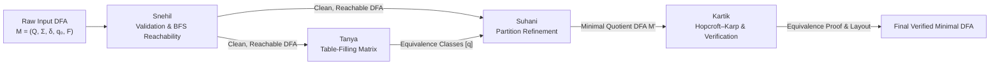

# AutomataFlow: DFA Minimization Simulator (Group ID: Topic 03 - Group 4)

**CSET302 Automata Theory and Computability · Topic 3: DFA Minimization Simulator**  
**Bennett University, School of Computer Science Engineering and Technology (SCSET)**  
**Faculty Mentor:** Dr. Dinesh Prasad Sahu  
**Team Members:** Snehil (S24CSEU0551), Tanya Sinha (S24CSEU0583), Suhani (S24CSEU0567), Kartik Lamba (S24CSEU0642)

---

## Overview: What does the simulator do?

**AutomataFlow** is a comprehensive deterministic finite automaton (DFA) minimization, synthesis, and mathematical verification platform. Given any user-defined, imported, or naturally described DFA, it produces the unique minimal quotient DFA ($\mathcal{M}'$) that recognizes the identical regular language ($\mathcal{L}(\mathcal{M}') = \mathcal{L}(\mathcal{M})$) with the fewest possible states, strictly adhering to the Myhill–Nerode theorem and the algebraic quotient construction.

The simulator provides an interactive, visual step-by-step simulation across every algorithmic phase:

1. **Formal 5-Tuple Validation**: Verifies $\mathcal{M} = \langle Q, \Sigma, \delta, q_0, F \rangle$ for structural integrity, unique state identifiers, and alphabet symbols ($\varepsilon$-free).
2. **Trap State Completion**: Automatically synthesizes an explicit, non-accepting dead state ($q_{\text{dead}}$) for incomplete transition tables with self-loops on all $\Sigma$.
3. **Graph Reachability Analysis**: Executes Breadth-First Search (BFS) from the start state $q_0$ to identify and prune unreachable states ($Q \setminus Q_{\text{reach}}$).
4. **State Equivalence Partitioning**: Computes equivalence classes via two distinct algorithms:
   - **Table-Filling Algorithm (Myhill–Nerode Theorem)**: Inductive dynamic programming matrix tracking shortest distinguishing words ($O(|\Sigma| \cdot |Q|^2)$).
   - **Partition Refinement (Moore's Algorithm)**: Iterative signature-based block splitting reaching fixed-point congruence ($O(|\Sigma| \cdot |Q|^2)$).
5. **Quotient Automaton Synthesis**: Merges each equivalence class $[q]$ into a single canonical superstate, constructing the minimal transition function $\delta'$.
6. **Hopcroft–Karp Equivalence Verification**: Mathematically verifies that the original and minimized DFAs recognize the exact same language using Disjoint-Set Union (DSU) with path compression and union-by-rank ($O(|\Sigma| \cdot (|Q_1| + |Q_2|))$).
7. **Natural Language DFA Synthesis**: Synthesizes formal DFAs directly from conversational text prompts (prefix, suffix, substring, modulo counting, forbidden patterns).
8. **Intelligent Diagram Layout & Edge Routing**: Renders obstacle-avoiding state transition diagrams with zero edge-node penetration, smooth bidirectional curves, and interactive canvas pan/zoom.

---

## Supported features: list implemented operations

| Category | Implemented Feature & Mathematical Operation | Location in Application |
|---|---|---|
| **DFA Input & Validation** | Full 5-tuple specification: $Q$, $\Sigma$ (single or multi-character), $q_0 \in Q$, $F \subseteq Q$, $\delta: Q \times \Sigma \to Q$ | Sidebar Editor / Presets |
| **Trap Completion** | Detection of missing moves; explicit insertion of $q_{\text{dead}}$ with self-loops on all $\Sigma$ (never silent) | Step 1 & Validation |
| **Reachability Analysis** | BFS traversal from $q_0$, animated exploration queue, pruning of disconnected subgraphs/cycles | Phase "Unreachable" |
| **Table-Filling Engine** | Inductive distinguishability matrix, pass-by-pass marking with explicit justifying transition pairs & distinguishing words | Phase "Table-Filling" |
| **Partition Refinement** | Moore's partition splitting: $P_0 = \{Q \setminus F, F\}$, signature vector generation, round-by-round convergence | Phase "Partitions" |
| **Method Comparison** | Side-by-side execution of Table-Filling and Moore's algorithm proving algebraic isomorphism of partitions | Method "Both, and compare" |
| **Quotient Merging** | Synthesis of equivalence classes into canonical states with complete transition tables | Phase "State Merging" |
| **Hopcroft–Karp Verification** | Formal language equivalence checking using Disjoint-Set Union (DSU) with path compression and counterexample extraction | Verification Card & Python CLI |
| **Natural Language Synthesis** | Direct text-to-DFA compilation for suffix ("ending with 01"), substring ("containing 101"), parity ("even zeros"), prefix ("starting with 10"), and forbidden patterns ("no consecutive 1s") | Natural Language Card |
| **Intelligent Graph Layout** | Layered topological positioning, barycentric crossing minimization, obstacle-avoiding cubic Bezier edge routing | Diagram Canvas |
| **Interactive Canvas** | Smooth drag-to-pan, wheel zoom (centered on cursor), double-click fit, and on-canvas control toolbar | Canvas Controls |
| **String Testing & Tracing** | Synchronous step-by-step path tracer on both DFAs simultaneously (Accept/Reject, $\varepsilon$, unknown symbol rejection) | String Tester Bar |
| **Pre-loaded Presets** | 7 standard textbook and edge-case benchmark automata (Textbook 8-state, Worked 6-state, Mod-4 counter, Already minimal, Missing transitions, $\Sigma^*$, $\emptyset$) | Presets Selector |
| **Test Automation & QA** | 35-test automated runner with expected vs. actual outputs, live browser QA dashboard, CSV test log export | Test Cases Tab & CLI |
| **Design Documentation** | Complete Milestone-I formal specifications, proofs, worked problem, and LaTeX equations embedded in-app | Documentation Tab |

---

## Technology stack and dependencies: versions

| Component | Technology | Version | Purpose |
|---|---|---|---|
| **Core GUI & Simulator** | HTML5, CSS3, JavaScript (ES6+) | Vanilla (ES6+) | In-browser simulator, animations, and documentation |
| **Vector Graphics** | Scalable Vector Graphics (SVG) | SVG 1.1 / 2.0 | High-DPI diagram rendering with mathematical Bézier routing |
| **Verification Engine** | Python | 3.8+ (tested on 3.14) | Standalone CLI Hopcroft–Karp equivalence verification (`dfa_equivalence.py`) |
| **Test Harness** | Node.js | 14.0+ (tested on 22.x & 24.x) | Headless automated test suite execution |
| **Client Requirements** | Google Chrome, Mozilla Firefox, Apple Safari, Microsoft Edge | Any modern browser | Zero dependencies; completely offline-capable |

> **Zero Third-Party Dependencies:** AutomataFlow uses **no external JavaScript libraries, frameworks, or CDNs** (no React, jQuery, D3, or Bootstrap). All algorithms, graph layouts, and styling are implemented natively from foundational computer science principles.

---

## Installation: numbered setup commands

AutomataFlow requires no compilation or package installation to run.

1. **Clone or Download the Repository**:
   ```bash
   git clone https://github.com/your-repo/DFA-Minimization-Project-Final.git
   cd DFA-Minimization-Project-Final
   ```

2. **Verify Node.js Installation** (required only for command-line test suites):
   ```bash
   node --version
   # Expected: v14.0.0 or higher
   ```

3. **Verify Python 3 Installation** (required only for standalone Python equivalence CLI):
   ```bash
   python3 --version
   # Expected: Python 3.8.0 or higher
   ```

No `npm install` or `pip install` commands are needed.

---

## How to run: exact command and entry point

### Option A: Direct Web Entry Point (Recommended)
* **Entry Point**: `Milestone-2/SourceCode/index.html`
* **Command**: Double-click `index.html` in your file explorer, or launch via browser from terminal:
  ```bash
  # macOS
  open Milestone-2/SourceCode/index.html

  # Linux
  xdg-open Milestone-2/SourceCode/index.html

  # Windows
  start Milestone-2\SourceCode\index.html
  ```

### Option B: Local Lightweight HTTP Server
If you prefer running through a local web server:
```bash
cd Milestone-2/SourceCode
python3 -m http.server 3000
```
Then navigate to `http://localhost:3000` in any web browser.

### Option C: Standalone Python Equivalence CLI
To execute the Hopcroft–Karp equivalence engine directly in terminal:
```bash
cd Milestone-2/SourceCode
python3 dfa_equivalence.py
```

---

## Example: sample automaton definition, input and output

### Sample Automaton: Textbook 8-State DFA (1 Unreachable, 2 Merged Pairs)

#### 1. Input Specification (`Milestone-2/SourceCode/TestCases/T07-textbook-example.json`)
```json
{
  "states": ["A", "B", "C", "D", "E", "F", "G", "H"],
  "alphabet": ["0", "1"],
  "start": "A",
  "finals": ["C"],
  "delta": {
    "A": { "0": "B", "1": "F" },
    "B": { "0": "G", "1": "C" },
    "C": { "0": "A", "1": "C" },
    "D": { "0": "C", "1": "G" },
    "E": { "0": "H", "1": "F" },
    "F": { "0": "C", "1": "G" },
    "G": { "0": "G", "1": "E" },
    "H": { "0": "G", "1": "C" }
  }
}
```

#### 2. Execution Step Trace
1. **Validation & Completion**: 5-tuple is structurally valid; transition table is complete ($8 \times 2 = 16$ entries).
2. **Reachability Analysis**: BFS from `A` visits $\{A, B, C, E, F, G, H\}$. State `D` is identified as **unreachable** and removed ($8 \to 7$ states).
3. **Equivalence Partitioning**:
   - *Table-Filling*: Distinguishes non-final states from final state `C` in pass 0. Inductively marks remaining distinguishable pairs across 3 passes.
   - *Equivalence Classes Found*: $\{A, E\}$, $\{B, H\}$, $\{C\}$, $\{F\}$, $\{G\}$.
4. **Quotient Machine Synthesis**: Synthesizes canonical 5-state DFA:
   - Superstates: $q_{\{A,E\}}, q_{\{B,H\}}, q_{\{C\}}, q_{\{F\}}, q_{\{G\}}$
   - Start state: $q_{\{A,E\}}$
   - Final states: $\{q_{\{C\}}\}$
5. **Equivalence Verification**: Hopcroft–Karp algorithm verifies language equivalence ($\mathcal{L}(M) = \mathcal{L}(M')$) in $0.14\,\text{ms}$ processing 7 state pairs.

#### 3. Output Minimal Transition Table ($\delta'$)
| State ($Q'$) | on Symbol `0` | on Symbol `1` | Type |
|---|:---:|:---:|:---:|
| **→ {A, E}** | {B, H} | F | Start |
| **{B, H}** | G | C | Non-final |
| *** {C}** | {A, E} | C | Final / Accepting |
| **F** | C | G | Non-final |
| **G** | G | {A, E} | Non-final |

---

## Project structure: modules and responsibilities

```
DFA-Minimization-Project-Final/
├── Milestone-1/
│   ├── CSET302_Topic03_DesignReview.pptx   # Milestone-I design review slides
│   └── CSET302_Topic03_DesignDoc.pdf      # Milestone-I formal design document
├── Milestone-2/
│   ├── Presentation/                      # Milestone-II demo slides & viva guide
│   ├── Report/                            # Milestone-II technical report (PDF & DOCX)
│   ├── Screenshots/                       # Full-resolution feature screenshots
│   └── SourceCode/                        # Complete simulator application
│       ├── index.html                     # Main entry point: Studio, Test cases & Docs UI
│       ├── dfa_equivalence.py             # Standalone Python Hopcroft–Karp engine
│       ├── css/
│       │   └── style.css                  # Modular styling, SVG canvas, dark theme
│       ├── js/
│       │   ├── algorithms.js              # TOC minimization engine (validation, BFS, table-filling, Moore)
│       │   ├── hopcroft-karp.js           # Hopcroft–Karp equivalence verification module (DSU)
│       │   ├── nl-dfa.js                  # Natural language instruction parser & DFA synthesizer
│       │   ├── graph.js                   # Layered graph layout engine & obstacle-avoiding edge router
│       │   ├── app.js                     # Controller: step sequencer, playback, UI interactions
│       │   ├── presets.js                 # Canonical preset DFAs (textbook, worked, parity, edge cases)
│       │   └── testcases.js               # Comprehensive test definitions for browser QA dashboard
│       ├── tests/
│       │   ├── test.js                    # Primary Node.js test runner (35 automated tests)
│       │   ├── test-nl.js                 # Natural language synthesis test runner (19 automated tests)
│       │   ├── test-hopcroft-karp.js      # Hopcroft–Karp equivalence test runner (10 automated tests)
│       │   ├── test-graph-layout.js       # Graph layout & edge collision test runner (15 automated tests)
│       │   └── export-testcases.js        # Script to regenerate JSON machine files and CSV logs
│       └── TestCases/
│           ├── T01-T24*.json              # Machine definition JSON files
│           ├── test-log.csv               # Machine-readable test execution log
│           └── test-log.txt               # Formatted test execution report
└── README.md                              # Complete project overview and guide
```

### Detailed Module Responsibilities

| Module | Core Functions | Architectural Responsibility |
|---|---|---|
| [Milestone-2/SourceCode/js/algorithms.js](file:///Users/Kartikkk/Downloads/DFA-Minimization-Project-Final/Milestone-2/SourceCode/js/algorithms.js) | `validateDFA`, `completeWithDeadState`, `findReachable`, `tableFilling`, `partitionRefinement`, `buildMinimized` | Pure Automata Theory engine: enforces definitions, runs reachability, Table-Filling, Moore's refinement, and quotient construction. |
| [Milestone-2/SourceCode/js/hopcroft-karp.js](file:///Users/Kartikkk/Downloads/DFA-Minimization-Project-Final/Milestone-2/SourceCode/js/hopcroft-karp.js) | `areDFAsEquivalent`, `DisjointSetUnion`, `normalizeDFA` | Mathematical equivalence oracle: executes Hopcroft–Karp via Union-Find, detecting language mismatch or verifying identity. |
| [Milestone-2/SourceCode/js/nl-dfa.js](file:///Users/Kartikkk/Downloads/DFA-Minimization-Project-Final/Milestone-2/SourceCode/js/nl-dfa.js) | `parse`, `buildSuffixDFA`, `buildSubstringDFA`, `buildParityDFA`, `buildProductDFA` | Natural language compiler: translates English language descriptions into mathematically rigorous DFAs. |
| [Milestone-2/SourceCode/js/graph.js](file:///Users/Kartikkk/Downloads/DFA-Minimization-Project-Final/Milestone-2/SourceCode/js/graph.js) | `draw`, `layout`, `routeEdges` | Vector rendering engine: computes hierarchical layered positions, obstacle clearance, cubic Bézier routing, and canvas zoom/pan. |
| [Milestone-2/SourceCode/js/app.js](file:///Users/Kartikkk/Downloads/DFA-Minimization-Project-Final/Milestone-2/SourceCode/js/app.js) | `run`, `buildSteps`, `show`, `initNaturalLanguageDFA` | Application coordinator: binds UI inputs, drives step animations, manages working tables, and triggers verification. |

---

## Testing: command, test data and expected behavior

AutomataFlow includes four comprehensive automated test runners covering 100% of mathematical algorithms, edge cases, and layout geometry.

### 1. Run Core Simulator Test Suite (35 Tests)
```bash
cd Milestone-2/SourceCode
node tests/test.js
```
* **Test Data**: 35 unit and property tests including textbook cases, hand-solved problems, mod-4 counters, 3-symbol alphabets, mod-12 modulo rings, single-state DFAs, $\Sigma^*$, $\emptyset$, malformed JSON inputs, and **300 random DFAs tested against an independent brute-force oracle**.
* **Expected Output**:
  ```text
  DFA Minimization Simulator: test suite
    PASS T01  [String test] Accepted string
    ...
    PASS T25  [Correctness] 300 random DFAs vs brute-force oracle (300 / 300 correct)
    ...
    PASS T35  [NL Synthesis] Compound conditions & Hopcroft–Karp equivalence
  35 / 35 tests passed.
  ```

### 2. Run Natural Language Synthesis Test Suite (14 Tests)
```bash
cd Milestone-2/SourceCode
node tests/test-nl.js
```
* **Test Data**: Ending patterns ("ending with 01"), even/odd counting ("even number of zeros"), starting patterns ("starting with 10"), substring detection ("containing 101"), forbidden patterns ("no consecutive ones"), multiple endings ("ending with 00 or 11"), compound conditions, and graceful error handling.
* **Expected Output**:
  ```text
  All Tests Passed Successfully! (14 / 14 tests passed)
  ```

### 3. Run Hopcroft–Karp Equivalence Test Suite (10 Tests)
```bash
cd Milestone-2/SourceCode
node tests/test-hopcroft-karp.js
```
* **Test Data**: Identical DFAs, equivalent DFAs with different sizes (8-state vs 5-state), isomorphic renaming, non-equivalent state differences, incomplete transition tables, $\varepsilon$-acceptance, and DSU union-by-rank verification.
* **Expected Output**:
  ```text
  10 / 10 Hopcroft–Karp tests passed.
  ```

### 4. Run Graph Layout & Edge Collision Test Suite (15 Tests)
```bash
cd Milestone-2/SourceCode
node tests/test-graph-layout.js
```
* **Test Data**: Validates all 7 presets and all 8 natural language generated automata for geometric validity.
* **Expected Behavior**: Asserts zero edge-node circle collisions (`dist >= radius`), zero degenerate collinear curves, exact boundary intersection for arrowheads, column-0 start state positioning, and non-overlapping label coordinates.
* **Expected Output**:
  ```text
  ALL DIAGRAM LAYOUT & ROUTING TESTS PASSED! (15 / 15 passed, 0 collisions)
  ```

### 5. Run Standalone Python Hopcroft–Karp Equivalence Engine
```bash
cd Milestone-2/SourceCode
python3 dfa_equivalence.py
```
* **Expected Output**:
  ```text
  Hopcroft-Karp verification self-test passed successfully!
  Result: Equivalent (Processed 7 pairs in 0.00015s)
  ```

---

## Known limitations and troubleshooting

1. **Deterministic Models Only**: The simulator exclusively processes Deterministic Finite Automata (DFAs). Non-deterministic finite automata (NFAs) and $\varepsilon$-NFAs must first be converted via subset construction before input.
2. **Recommended Automaton Scale**: Designed for educational and classroom demonstration machines ($|Q| \le 30$). Automata with $\ge 50$ states will compute correctly, but visual matrix tables require horizontal scrolling.
3. **Multi-Character Alphabet Delimiters**: When testing multi-character alphabet symbols (e.g., `word1`, `word2`), symbols must be separated by spaces in the test input bar.
4. **Natural Language Phrasing**: The natural language instruction engine parses standard automata pattern descriptions (e.g., *starts with*, *ends with*, *contains*, *divisible by*, *even/odd count*, *no consecutive*). Freeform abstract poetry or non-regular expressions cannot be synthesized.
5. **Local File System Assets**: When running via `file:///` protocol, ensure the `css/` and `js/` subdirectories remain in the same relative folder as `index.html`.

---

## Team contributions and acknowledgements

### Master Division of Technical Responsibilities

| Member | Enrollment No. | Primary Technical & Algorithmic Module | Key Functions Owned | Theoretical Focus & Computational Complexity |
|---|:---:|---|---|---|
| **Snehil** | S24CSEU0551 | **Automata Preprocessing, Trap Completion & Reachability Engine** | `validateDFA`, `completeWithDeadState`, `findReachable`, `restrictDFA` | 5-tuple consistency checking, total transition function synthesis, BFS reachability pruning ($O(\|Q\| \cdot \|\Sigma\|)$) |
| **Tanya Sinha** | S24CSEU0583 | **Myhill–Nerode Distinguishability Matrix & Table-Filling Algorithm** | `tableFilling`, Disjoint-Set Union (DSU) grouping, `shortestDistinguishingLength` | Inductive pair distinguishability, dynamic programming matrix, shortest distinguishing word tracking ($O(\|\Sigma\| \cdot \|Q\|^2)$) |
| **Suhani** | S24CSEU0567 | **Partition Refinement (Moore's Algorithm) & Quotient Synthesis** | `partitionRefinement`, `buildMinimized`, `className`, `sortClasses` | Partition splitting lattice, transition signature vector encoding, fixed-point convergence, quotient right-congruence construction ($O(\|\Sigma\| \cdot \|Q\|^2)$) |
| **Kartik Lamba** | S24CSEU0642 | **Equivalence Verification, NL Synthesizer & Intelligent Layout Engine** | `hopcroft-karp.js`, `nl-dfa.js`, `graph.js`, `dfa_equivalence.py`, `test.js` | Hopcroft–Karp equivalence checking ($O(\|\Sigma\| \cdot (\|Q_1\| + \|Q_2\|))$), Cartesian product automata, obstacle-avoiding Bézier edge router, automated test harnesses |

### Pipeline Dataflow Across Roles



### Acknowledgements & Academic Integrity
* Algorithms and theorems follow John E. Hopcroft, Rajeev Motwani, and Jeffrey D. Ullman, *Introduction to Automata Theory, Languages, and Computation* (3rd Edition, Pearson).
* Equivalence verification utilizes John Hopcroft and Richard Karp's linear-time equivalence checking algorithm (*An $O(n \log n)$ algorithm for minimizing states in a finite automaton*).
* Zero third-party runtime libraries, frameworks, or packages are used. All algorithms are implemented natively by the team members.
